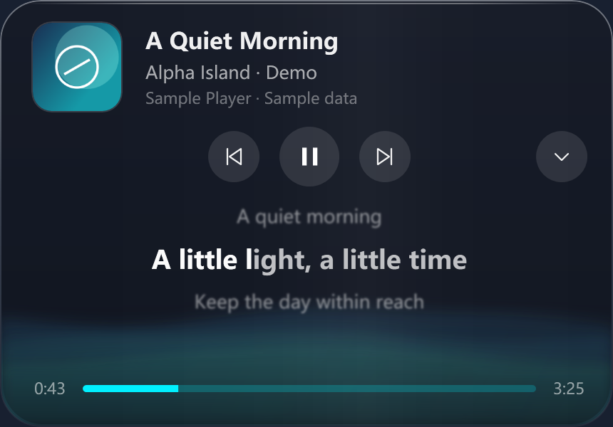
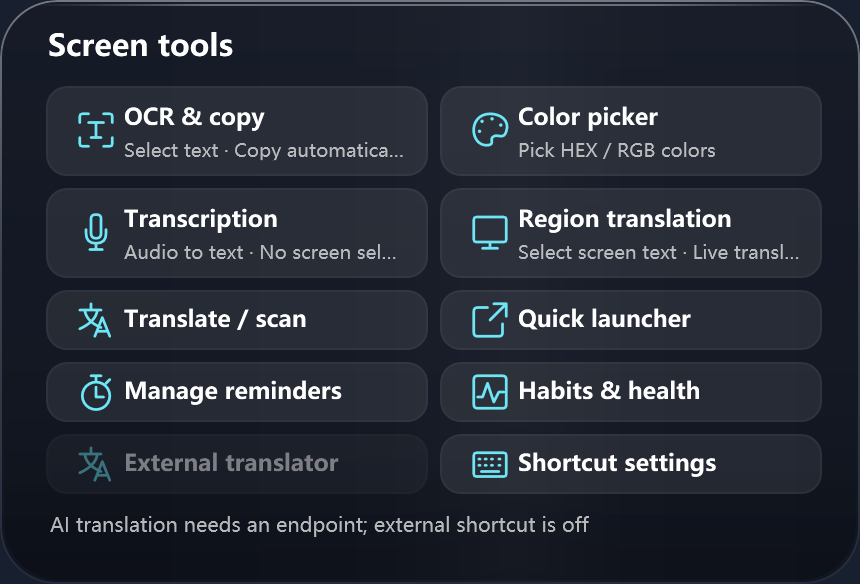
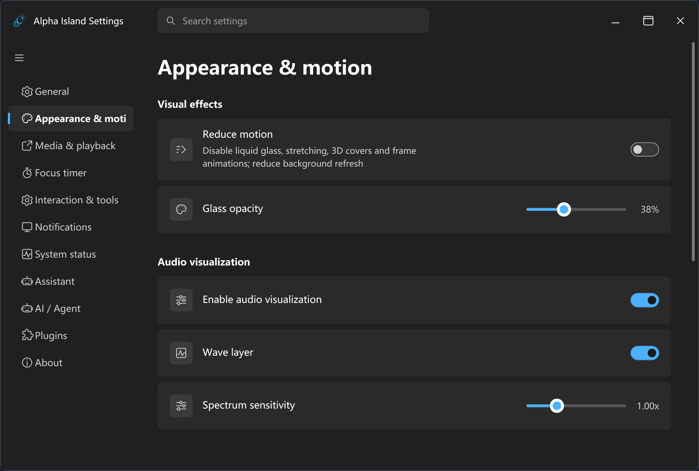

# Alpha Island

[简体中文](README.md) · [English](README.en.md)

**A Windows application for desktop status display and tool integration.**

Alpha Island is built with C# and WPF. It displays media, notifications, system and device status, and provides screen tools, reminders and plugin integration. The main panel appears at the top of the primary display by default and supports status bar mode, summary view and card view. Auxiliary panels display other activities. The interface supports liquid glass effects, component switching and content pinning.

**[Download the app](https://github.com/l-egend/alpha-island/releases/tag/v0.2.32) · [Download optional plugins](https://github.com/l-egend/alpha-island/releases/tag/plugins-v0.2.32) · [Plugin catalog](https://github.com/l-egend/alpha-island/tree/plugins) · [Report an issue](https://github.com/l-egend/alpha-island/issues)**



## Download and install

Current version: **0.2.32**. Requires **x64** Windows 10 version 2004 (19041) or later, or Windows 11.

1. Download `AlphaIsland-0.2.32-win-x64-Setup.exe` from the [app release](https://github.com/l-egend/alpha-island/releases/tag/v0.2.32) and run it.
2. The installer includes the .NET runtime; no SDK is required. Exit Alpha Island before running an update installer.
3. Optional plugins are distributed separately. Open Settings → Plugins → Open plugin folder, copy the complete extracted plugin folder there, then refresh and enable it.

App updates preserve existing configuration and installed plugins. The installer contains no settings or API keys from the development computer. See the [quick start](docs/QUICKSTART.en.md) for installation, data locations and troubleshooting.

## Features

| Module | What it does |
| --- | --- |
| Media and lyrics | Windows media sessions, playback controls, artwork and live spectrum; synchronized lyrics, translations and word highlighting. Reorder lyric sources, add custom sources or import local LRC files. Four dots bridge intros and identifiable instrumental breaks. |
| Notifications | Filter, stack, read and dismiss notifications; choose a notification sound. |
| Devices and system | CPU, memory, network speed, power and supported device batteries; Bluetooth connection and charging alerts. |
| Screen tools | Screen OCR, color picker, text translation and QR scanning; separate speech recognition and selected-region translation. |
| Time and focus | Pomodoro, natural-language reminders, productivity statistics, local habit suggestions and system health alerts. |
| Desktop tools | Clipboard history, file shelf, quick launcher and download status. |
| Appearance and interaction | Liquid glass, multi-panel layout, welcome animations and sounds, game mode, automatic collapse for maximized browsers. |
| Optional extensions | API Chat, Local Agents, earbud controls, 2.4G batteries, phone connection, network data and an example clock. |

Speech, translation and online models require an appropriate service configuration. Device readings and controls depend on Windows, hardware protocols and plugins; unreported data is shown as unknown. The main panel is located on the system's primary display and responds to primary-display, resolution, scaling and work-area changes.

## Interface and controls

| Screen tools | Settings |
| --- | --- |
|  |  |

These images were generated from the current app's actual UI controls with sample data. They contain no real notifications, accounts or device records.

- Click or hover over the panel to expand it, and click outside to collapse it. Right-click supported content to pin it.
- The right-hand component switcher supports clicking, scrolling and a hold menu. Scrolling inside a card scrolls its contents.
- Click an auxiliary panel to open its activity. Maximized or full-screen browsers can switch the main panel to status bar mode; click to expand temporarily.
- Open Settings from the tray icon to configure shortcuts, welcome presets, game mode and startup.
- Settings → General → Interface language offers system default, Simplified Chinese and English. Restart to apply the language.

See [Terminology](docs/TERMINOLOGY.md) for panel and view definitions.

## Plugins and branches

| Branch / download | Purpose |
| --- | --- |
| [master](https://github.com/l-egend/alpha-island/tree/master) | Main application source and documentation. |
| [plugins](https://github.com/l-egend/alpha-island/tree/plugins) | Independent plugin sources, bilingual guides and development examples. |
| [App release](https://github.com/l-egend/alpha-island/releases/tag/v0.2.32) | Windows x64 installer and SHA-256 checksums. |
| [Plugin release](https://github.com/l-egend/alpha-island/releases/tag/plugins-v0.2.32) | Seven individual installable ZIPs, a combined bundle, source and optional native bridge. |

Install only what you need. `AlphaIsland-plugin-source-0.2.32.zip` is for development and cannot be installed directly as a plugin. See the [plugin catalog](https://github.com/l-egend/alpha-island/blob/plugins/README.en.md) for installation and requirements.

## Configuration and privacy

Settings and local records are stored in `%LOCALAPPDATA%\alpha-island\config`. User plugins normally live in `%LOCALAPPDATA%\alpha-island\plugins`. Open the actual folders from Settings.

API keys are encrypted with DPAPI for the current Windows user and must be entered again after migrating to a different account. Online models, recognition, translation and lyric sources contact the configured services; enable them as needed. Diagnostic exports redact recognized secrets, paths and personal fields. Review attachments and screenshots before sharing them.

## Build from source

Requires Windows and the **.NET 8 SDK**. In Visual Studio, install the **.NET desktop development** workload.

```powershell
git clone https://github.com/l-egend/alpha-island.git
cd alpha-island
dotnet restore alpha-island.sln
dotnet build alpha-island.sln -c Release
dotnet run --project alpha-island.csproj -c Release --no-build
```

Plugins live on the separate `plugins` branch and are not required to build the app. The [lyric-source import specification](Assets/Lyrics/歌词源导入规范.md) describes lyric extensions.

## Contributing and assets

Use [Issues](https://github.com/l-egend/alpha-island/issues) for bugs and suggestions, and Pull Requests for changes. Include the app and Windows versions, reproduction steps, resolution and scaling. Remove private content from logs and screenshots.

Some assets are sourced from third parties; rights remain with their respective owners. For rights concerns, please [contact the author](https://github.com/l-egend/alpha-island/issues). See the notices for [device icons](Assets/Bluetooth/SOURCES.md), [welcome assets](Assets/Greetings/SOURCES.md) and [built-in sounds](Assets/Sounds/SOURCES.md). Resource and dependency licenses are included in their respective directories and release packages.
