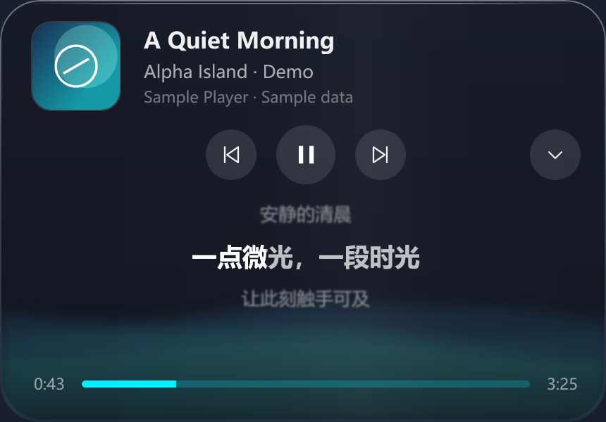
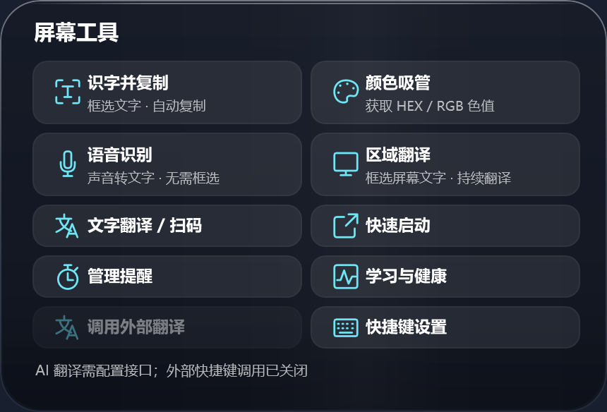
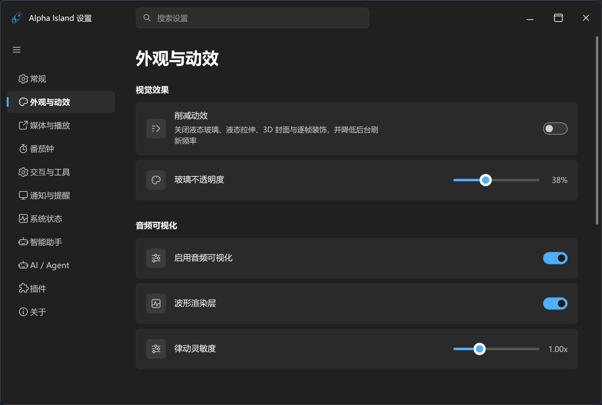

# Alpha Island

[简体中文](README.md) · [English](README.en.md)

**Windows 桌面状态显示与工具集成应用。**

Alpha Island 使用 C# 与 WPF 开发，集中显示媒体、通知、系统和设备状态，并提供屏幕工具、提醒与插件接入。主面板默认位于主显示器顶部，支持状态条模式、摘要视图和卡片视图；辅助面板用于展示其他活动。界面支持液态玻璃效果、组件切换与内容置顶。

**[下载主程序](https://github.com/l-egend/alpha-island/releases/tag/v0.2.32) · [下载可选插件](https://github.com/l-egend/alpha-island/releases/tag/plugins-v0.2.32) · [插件目录](https://github.com/l-egend/alpha-island/tree/plugins) · [问题反馈](https://github.com/l-egend/alpha-island/issues)**



## 下载与安装

当前版本：**0.2.32**。支持 Windows 10 2004（19041）及以上、Windows 11，**x64**。

1. 从 [主程序 Release](https://github.com/l-egend/alpha-island/releases/tag/v0.2.32) 下载 `AlphaIsland-0.2.32-win-x64-Setup.exe` 并运行。
2. 安装包自带 .NET 运行库，无需另装 SDK。升级时先退出 Alpha Island，再运行新版安装包。
3. 可选插件单独下载，主安装包不附带。打开“设置 → 插件 → 打开插件目录”，放入解压后的完整插件文件夹，再刷新并启用。

现有配置和已安装插件在主程序升级时保留。安装包不包含开发电脑的个人配置或密钥。安装、数据和排查步骤见 [快速开始](docs/QUICKSTART.zh-CN.md)。

## 功能

| 模块 | 可以做什么 |
| --- | --- |
| 媒体与歌词 | 读取 Windows 媒体会话，控制播放、显示封面与实时频谱；同步歌词、翻译与逐字高亮，支持歌词源排序、自定义源和本地 LRC。前奏与可识别的间奏用四个圆点过渡。 |
| 通知中心 | 汇总通知，按应用筛选、堆叠、查看和清除；支持自定义提示音。 |
| 设备与系统 | CPU、内存、网速、电源与受支持设备的电量；蓝牙连接及充放电提示。 |
| 屏幕工具 | 截图 OCR、颜色吸管、文字翻译、扫码；语音识别和框选区域翻译分别启用。 |
| 时间与效率 | 番茄钟、自然语言提醒、生产力统计、本地习惯建议与系统健康预警。 |
| 桌面工具 | 剪贴板历史、文件中转、快速启动与下载状态。 |
| 外观与交互 | 液态玻璃、多面板布局、欢迎动画与音效、游戏模式、浏览器最大化时自动收起。 |
| 可选扩展 | API 对话、本机 Agent、耳机控制、2.4G 电量、手机连接、网络数据与时钟示例。 |

语音、翻译与在线模型需要配置相应服务。设备读数和控制能力取决于 Windows、硬件协议及插件；未上报的数据会显示未知。主面板位于系统主显示器，响应主显示器、分辨率、缩放和工作区变化。

## 界面与操作

| 屏幕工具 | 设置 |
| --- | --- |
|  |  |

以上图片由当前版本的实际界面控件使用样例数据生成，不含真实通知、账号或设备记录。

- 面板支持单击或悬停展开，点击面板外部收起；可对支持的内容右键置顶。
- 右侧组件切换控件支持单击、滚轮切换和长按菜单；卡片内的滚轮用于滚动内容。
- 点击辅助面板打开对应活动。浏览器最大化或全屏时，主面板可自动切换为状态条模式；单击可临时展开。
- 托盘图标打开设置；可设置快捷键、欢迎组合、游戏模式和开机自启。
- “设置 → 常规 → 界面语言”可选择跟随系统、简体中文或 English，重启后应用。

界面名称与视图定义见 [术语说明](docs/TERMINOLOGY.md)。

## 插件与分支

| 分支 / 下载 | 用途 |
| --- | --- |
| [master](https://github.com/l-egend/alpha-island/tree/master) | 主程序源码和文档。 |
| [plugins](https://github.com/l-egend/alpha-island/tree/plugins) | 独立插件源码、中英文使用说明与开发示例。 |
| [主程序 Release](https://github.com/l-egend/alpha-island/releases/tag/v0.2.32) | Windows x64 安装包和 SHA-256 校验。 |
| [插件 Release](https://github.com/l-egend/alpha-island/releases/tag/plugins-v0.2.32) | 7 个单独安装 ZIP、合并包、源码包及可选原生桥接。 |

按需安装插件即可。`AlphaIsland-plugin-source-0.2.32.zip` 用于开发，不能直接作为插件安装；安装方式和各插件条件见 [插件目录](https://github.com/l-egend/alpha-island/blob/plugins/README.md)。

## 配置与隐私

设置与本地记录保存在 `%LOCALAPPDATA%\alpha-island\config`，用户插件通常位于 `%LOCALAPPDATA%\alpha-island\plugins`。可从设置打开实际目录。

API 密钥使用当前 Windows 用户的 DPAPI 加密保存，迁移到其他账号后需重新输入。在线模型、识别、翻译和歌词源会访问配置的服务；请按需启用。导出诊断包会对已识别的密钥、路径和个人字段脱敏，提交前仍请检查附件及截图。

## 从源码构建

需要 Windows 和 **.NET 8 SDK**；使用 Visual Studio 时安装“.NET 桌面开发”工作负载。

```powershell
git clone https://github.com/l-egend/alpha-island.git
cd alpha-island
dotnet restore alpha-island.sln
dotnet build alpha-island.sln -c Release
dotnet run --project alpha-island.csproj -c Release --no-build
```

插件位于单独的 `plugins` 分支，不是构建主程序的前提。歌词扩展见 [歌词源导入规范](Assets/Lyrics/歌词源导入规范.md)。

## 参与与资源

欢迎通过 [Issues](https://github.com/l-egend/alpha-island/issues) 反馈问题，通过 Pull Request 提交改进。请附上版本号、Windows 版本、复现步骤、分辨率与缩放；日志和截图请去除私人内容。

素材来源与许可见 [蓝牙图标](Assets/Bluetooth/SOURCES.md)、[欢迎素材](Assets/Greetings/SOURCES.md) 和 [内置音效](Assets/Sounds/SOURCES.md)。插件及原生桥接的许可随独立包提供；角色插画与语音的权利归各自权利人。
